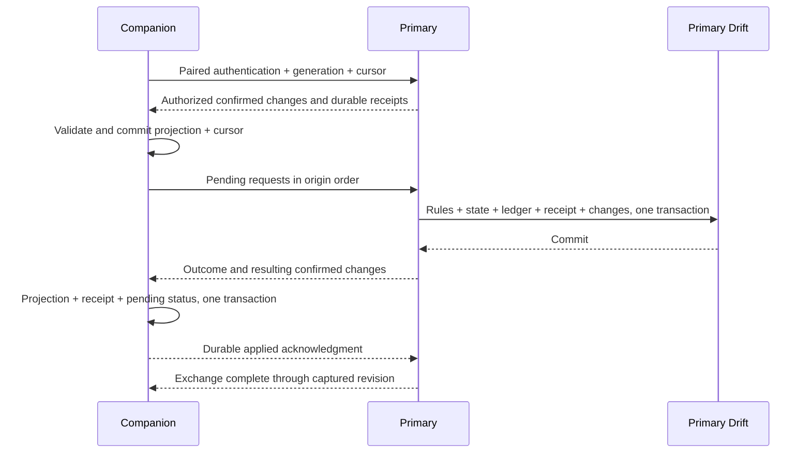

# Nearby Family Synchronization Implementation Plan

Date: 2026-11-06. Inspected baseline: `9088521`, app 0.5.0+12, Drift schema6, Flutter 3.35.7, iOS 13 minimum. Status: production implementation proposal; separate optical and synthetic nearby probes are described in [N1b evidence](research/nearby-enrollment-probe.md). No real family synchronization has been implemented or verified on devices. [ADR 0004](adr/0004-nearby-family-sync.md) and [ADR 0005](adr/0005-custom-particle-pairing.md) record the accepted nearby-sync and custom-optical product decisions.

## 1. Outcome and task contract

Pair devices once by scanning a branded visual code. For daily use, both people open Pennywood and tap Sync. The apps discover the previously authorized peer, authenticate, exchange outstanding requests and confirmed records, and show the result without another code, routine device selection, or manual Wi-Fi switching. Internet access and a shared Apple Account are not prerequisites.

The owner explicitly chose one primary accounting device. It commits the family's financial state; other devices submit permitted requests or read confirmed information. It need not remain online continuously. When devices are apart, requests wait and companion balances remain at their last confirmed revision.

| Contract | Scope |
|---|---|
| This delivery | Documentation, accepted product ADR, future feature IDs, and synchronized roadmap links. No app, schema, archive, signing, credential, dependency, or release change |
| Future implementation | Existing Dart domain/data modules, narrow native iOS networking/camera adapters, Flutter pairing/sync UI, migrations, backup compatibility, behavior/native tests, and their documentation |
| Protected behavior | Every local feature in [the matrix](23-feature-regression-matrix.md), particularly FAMILY-002, TASK-001/002, WISH-001/002, MONEY-001, INVEST-001/002/003, LOAN-001/002, DATE-001, AUTH-001/002, DATA-001/002/003, UI-001/002 and UI-004 through UI-008 |
| Acceptance | Authorized requests survive restart, apply once at the primary, and reach only authorized children; confirmed payment reaches the companion once; a failed or interrupted exchange never implies success |
| Data implications | Proposed schema7 and a new archive version, with explicit migrations and retained old readers; no balance reset, live SQLite sharing, credential cloning, or independent multi-writer merge |
| Excluded from this release | CloudKit, remote internet synchronization, a custom backend, BLE fallback, acoustic transfer, automatic primary election, independent financial writers, Android/Web/desktop targets, and continuous background synchronization |
| Delivery rules | One bounded branch/PR per stage, exact-candidate checks and privacy review. Planning approval is not authorization to merge, distribute, or claim device acceptance |

All proposed native files and table names below are implementation targets, not existing interfaces. Protocol limits are initial engineering choices to measure in N1; they are not previously observed performance results. No existing behavior may disappear merely because an intermediate stage does not cover it yet.

## 2. Current code and required seams

| Owning source | Current fact | Required change |
|---|---|---|
| [main.dart](../lib/main.dart) | Opens one Application Support SQLite file | Retain one local database; load local family/device mode before admitting writes |
| [service.dart](../lib/data/service.dart) | `execute` checks local authority, applies rules, and stores state/ledger/operation together | Keep it the business entry; add explicit local-primary versus remote-request handling and atomic replication metadata |
| [controller.dart](../lib/app/controller.dart) | Generates an operation ID during each `perform`; calls `restore` on load/resume | Persist companion request identity before transport; replica load/resume must never perform monetary catch-up |
| [engine.dart](../lib/domain/engine.dart) and [model.dart](../lib/domain/model.dart) | `catchUp` settles money; record IDs use a per-child increasing sequence | Execute only at the primary for replicated accounts; keep existing canonical IDs and map companion draft references to returned IDs |
| [database.dart](../lib/data/database.dart) | Normalized schema6 rows, unique task/day and payment constraints | Retain these constraints; add device state, durable requests/receipts and revisioned changes |
| [auth.dart](../lib/data/auth.dart) | In-process capabilities and local Keychain credentials | Separate local parent unlock from paired-device grants; a companion can never mint primary parent capability |
| [backup.dart](../lib/data/backup.dart) | Whole-family archives assume exactly two children and contain no credentials | Keep backup and scoped replication codecs separate; a one-child replica is not a complete family backup |
| [wish_home.dart](../lib/features/wish_home.dart), [screens.dart](../lib/app/screens.dart) | Queries all local children; backgrounding locks parent access | Filter by device grant; retain local lock behavior; own the foreground sync lifecycle independently of page navigation |
| [AppDelegate.swift](../ios/Runner/AppDelegate.swift) | Native file import/export channel only | Register small nearby/camera adapters; do not add networking or accounting logic to file-picker callbacks |

Use a small `NearbySync` module interface: begin pairing, join pairing, start sync, stop sync, observe state, and revoke a peer. Its implementation owns discovery, authentication, durable progress, ordering and reconnects. UI callers do not exchange SQL or raw protocol frames. Native transport and a deterministic test transport are the two concrete adapters at the transport seam; do not build a plugin registry for hypothetical future BLE/cloud transports.

## 3. Device roles and data ownership

| Device mode | Local behavior | Permitted remote behavior |
|---|---|---|
| Existing standalone family | Current complete local child/parent workflow | None until the owner enables nearby sharing |
| Primary family device | Current complete workflow, parent unlock and all financial posting | Admits devices; processes child requests; exports granted confirmed state; revokes peers |
| Child companion | Reads granted children; saves child intents/drafts and pending requests | Connects only to its primary; cannot approve, pay, fund, change family terms, set budgets, or unlock a primary role |
| Viewer companion | Reads the child scopes granted by the primary | No business writes. A second parent's phone may use this mode without becoming a second financial writer |

The primary selects one or both existing child profiles during pairing. A shared child iPad may receive both; a single-child device receives only that child. It must not receive the other child's rows and merely hide them in the UI. Viewer access can cover both children, but the grant remains explicit. Credential sharing does not change device mode.

All canonical tasks, wishes, money, holdings, budgets, terms, debt, payment links, business dates and ledger entries originate from the primary's business transactions. Companion drafts and transport metadata are separate. Theme, navigation, selected child, ordinary forms, scene position and learning simulations remain device-local; preserve existing scene/archive data without adding scene synchronization.

A family may have multiple companions, but no companion-to-companion forwarding or mesh is needed. The primary serializes incoming business work and maintains separate progress per peer. Accept only enrolled peers which have also started a sync session; do not list unrelated nearby devices during daily sync.

## 4. Pairing and everyday interaction

### First setup

1. The existing family owner unlocks the parent area, opens Family / Nearby devices, selects Add device, and chooses its allowed role/children. If this is the first peer, this device is explicitly designated primary.
2. Display the pairing artwork and a short expiry indicator. The other device chooses Join an existing family from onboarding and opens its camera. An already paired device uses its device-management page only when deliberately replacing its pairing.
3. Scanning identifies a short-lived enrollment session and establishes its authenticated connection. Both screens identify the device and proposed role/child scope. The primary parent confirms the admission; scanning alone grants no access.
4. Persist pairing in a recoverable pending/active handshake, then transfer an authorized baseline. Show Ready only after enrollment and the baseline commit succeed. Close the camera and remove the code.
5. Future sessions use the saved device-pair credential. Showing a code again is reserved for adding/replacing a device or explicit recovery, never routine retry.

Do not silently merge another locally created family. An empty installation can join directly. A nonempty standalone installation must preserve and verify its encrypted backup before an explicit conversion; show the affected family and last-write time. Two independently edited copies require owner reconciliation on the chosen primary before joining. Never infer family equality from child names or the local `real` ID; use the stable `global_id`.

### Custom particle visual code

The owner rejected the visible standard-QR finder structure and chose custom visual encoding/recognition in [ADR 0005](adr/0005-custom-particle-pairing.md). Use a circular particle field with no square lattice, three finder boxes or embedded QR. Five small round locator constellations and fixed data particles carry actual enrollment information; only the softer outer decoration animates. Preserve the existing paper/chestnut/green/blue-gray design direction and a fully functional static Reduce Motion state.

The [optical specification](29-particle-pairing-code.md) defines a concrete experimental profile: a 64-byte enrollment payload, RS(96,64) correction, 768 position-coded particles, asymmetric locator geometry and bounded recognition checks. These are format candidates to validate, not a frozen or device-proven standard. The local [18-case synthetic experiment](../evidence/public/particle-code-experiment.json) establishes only that the rendered format can round-trip under its listed artificial transformations.

AVFoundation supplies video frames. Pennywood must implement locator detection, orientation/mirror handling, projective mapping, dot sampling, correction and payload validation; the system QR decoder cannot recognize this pattern. Initial N1 targets a roughly 280-340 pt field where space permits, then measures screen-to-camera sampling at actual phone/tablet distances and window sizes. Neither density nor the proposed three-second scan target is a proven device result.

Keep data/locators fixed while scanning; animation cannot move, recolor into bit values, or cover protected points. Never capture a real enrollment secret in public artwork/logs. Handle camera permission, missed locators, glare, invalid/expired payloads and unsupported profiles explicitly. Failure does not silently fall back to the standard QR appearance the owner rejected. The full optical, dependency and N1a/N1b gates are in the separate specification.

### Daily sync

Place one labeled Sync action in the journal's shared top-level controls, available in child and parent areas without adding another main navigation destination. Device management stays under Family. The first device to tap waits; the second tap causes automatic discovery/authentication. The primary does not need to unlock to exchange already authorized child requests or confirmed results; parent operations still require the existing local unlock and actual-payment confirmation.

| UI state | Meaning and action |
|---|---|
| Not paired | Offer first-time pairing; no fake online indicator |
| Waiting for paired device | Discovery is active; explain that both apps must be open; Cancel is available |
| Connecting | Authenticate the previously paired identity; no repeat scanner or chooser |
| Syncing | Show request/record progress with stable labels, not fabricated percentages |
| Synced through a revision | Both sides have durable acknowledgment for the captured exchange; summarize submitted tasks and newly received results |
| Synced, with work needing attention | Transport completed but a request needs revised terms, lacks funds, or was rejected; retain its explanation separately |
| Interrupted / Unable to connect | Keep confirmed state and pending requests; Retry restarts discovery without re-pairing |
| Update or re-pair required | Protocol incompatibility, revoked grant or recovery generation changed; explain the precise next action |

After the first exchange, keep the foreground session available for up to two minutes of inactivity while the parent visits Pending and checks/pays. New committed changes are sent automatically during that session; approval does not require another pair of taps. This is a bounded foreground session, not a background listener. Both ends can stop it. Once it ends, later changes wait for the next explicit sync.

Starting targets: a 60-second discovery window, a 15-second connection/handshake attempt, and a 30-second no-progress transfer timeout. Retry a transient connection up to twice within the same user-started window. Backgrounding stops camera/discovery/listener/connections and invalidates in-flight UI callbacks; resuming preserves progress and offers Resume sync. Rotation/window resizing preserves the session and ordinary forms. Parent relocking rules remain intact.

Use 44 pt minimum touch targets, the existing 52 pt primary button, live but nonrepetitive VoiceOver state announcements, text alongside state colors, large-text reflow, and a stable focus target after completion/failure. Do not prevent ordinary navigation or close financial forms to update a sync badge.

## 5. Native transport and authenticated enrollment

Use Swift `NWBrowser`, `NWListener` and `NWConnection` with Bonjour and `includePeerToPeer` on both discovery and connection/listener parameters. The primary listens; companions connect. Prefer one reliable TCP stream with explicit message framing. Preserve iOS 13; do not copy iOS 26-only Network APIs, QUIC examples, or the full newer DeviceDiscoveryUI sample. [S1-S3]

Declare a fixed Bonjour TCP service and the local-network purpose string; add the camera purpose string for scanning. Use the platform's declaration/permission requirements, including local-network consent on iOS 14+. Ordinary Bonjour browsing of the declared service is distinct from raw multicast. No CloudKit container, shared Apple Account, microphone permission, audio background mode or custom Core Bluetooth service is needed for this implementation. Do not request speculative background entitlements. Stop a companion's browsing before opening its selected connection, and restart discovery only when needed. [S1-S5, S8]

Apple peer-to-peer Wi-Fi can provide a path without a shared access point. It is not a promise that every router, VPN, managed network, radio state or device combination works. Do not silently fall back to BLE or instruct users to change Wi-Fi during ordinary use. After an actual failure, report the verified limitation and permission/radio checks. Distinguish denied discovery from an absent peer, and Control Center disconnection from disabling a radio in Settings. N1 must demonstrate the no-shared-router case before it is advertised. [S1-S3, S7-S9]

### Credential and session design

- Generate a random device ID and a separate 256-bit credential per primary/companion pair. Store sync secrets in nonsynchronizable `WhenUnlockedThisDeviceOnly` Keychain items; retain the existing separate parent-credential policy. Database rows contain references and grant state, never the secret or parent passcode.
- The particle code carries an optical format version, enrollment session ID, expiry hint, and random 256-bit one-time bootstrap secret. The session ID also serves as an opaque discovery hint. It carries no family ledger, child names, password or permanent key. Expire it after two minutes, invalidate it on cancel/background, and serialize admission so two scanners cannot consume the same enrollment.
- The initial transport candidate is Network TLS 1.2 PSK, using the older API and a supported authenticated-encryption cipher suite. Apple's example supplies `sec_protocol_options_add_pre_shared_key` and `TLS_PSK_WITH_AES_128_GCM_SHA256`. Set the minimum and maximum TLS version to 1.2 and verify the negotiated suite in N1; the 256-bit PSK does not turn this AES-128 suite into AES-256. Require encryption and authentication; never accept arbitrary certificates or downgrade to plaintext. TLS-PSK on this API does not support TLS 1.3 or QUIC. [S1, S6]
- Parent confirmation binds the grant to the enrollment transcript, device IDs and allowed children. Transfer a fresh permanent pair credential over the authenticated bootstrap session. Persist pending enrollment before acknowledging key installation; use the permanent credential to finish activation. Retrying a half-completed activation reuses its pending identity and cannot create a second device grant.
- A prepared peer cannot read business data until the primary's active grant commits. If the final reply is lost, reconnecting with the prepared permanent credential queries activation status. Keychain/SQLite are not one transaction: explicit pending states and restart repair must handle either write succeeding first. Erase expired/orphaned credentials without clearing unrelated Keychain items.
- Daily authentication uses the permanent pair key and checks family identity, primary ID, authority generation, device status and child grant before any data is sent. Treat Bonjour names and client-declared roles as untrusted hints. Advertisements expose only a generic app service and ephemeral discovery identifier, never family names, balances or child names.
- Revoke a peer at the primary, stop its session, and reject its key on future connection. Revocation cannot erase data already cached on an offline device. Re-pairing creates a fresh key and requires another parent-approved scan. A companion that forgets the primary retains pending work locally but cannot send it until an explicit recovery decision.

Pure TLS-PSK has no forward-secrecy guarantee. Someone who captures both the enrollment secret and the relevant handshake traffic may recover transferred credentials. Short expiry alone does not fix that. N1 must review this threat, cipher negotiation, secret visibility and lifecycle before accepting this candidate for production. If stronger enrollment protection is required, use a reviewed standard authenticated key-exchange/TLS identity design and document its dependency/compatibility decision; do not invent a cryptosystem around the custom optical format. No secrets or security guarantees are inferred from decorative animation.

## 6. Requests, confirmed state and conflicts

A companion persists an intent before attempting delivery. Its public operation ID includes a random origin device ID and random request ID; a per-origin monotonic sequence establishes local order. Canonical wish/task/holding/ledger IDs remain assigned by the primary. Drafts reference other drafts by request ID, and accepted replies persist their canonical ID mapping before dependent intents become sendable. A reconnect never generates a replacement operation ID for the same intent.

Every command includes protocol version, family identity, authority generation, origin device, allowed child, operation ID, origin sequence, command type, typed payload, observed revision/terms, and claimed occurrence time. The primary derives the effective role from its grant, validates types/bounds and an explicit command allowlist, and applies the business entry with that scope. Do not forward arbitrary `Engine.execute` action names or trust `actorRole=parent` from the wire.

| Workflow | Companion offline behavior | Primary processing and final result |
|---|---|---|
| Add/edit/select/archive wishes | Durable draft/pending overlay; confirmed wish history remains visible | Check ownership, payment links and object revision; accept once or retain a conflict for explicit editing |
| Savings milestone / restoring an archived wish | Queue the existing child intent; no provisional milestone credited as money | Validate against confirmed accumulation and wish state; preserve the distinction between savings and actual gift receipt |
| Recurring task submit / withdraw / rework | Queue intent and show locally saved / not yet delivered separately from parent review | Enforce child/template/business-day uniqueness and existing state; parent check and payment remain distinct |
| Temporary task accept / submit | Queue against the offered task revision | Reject changed/cancelled offers; never silently accept different pay or standards |
| Advance request / accept / cancel | Queue intent against current offer and quoted terms | Preserve offer, child acceptance and actual funding sequence; no wallet credit from an advance |
| Deposit, redeem, dividend choice, withdrawal request, repayment | Retain the child's exact intent and quote; confirmed money does not change until acceptance | Re-evaluate money, consent, promise version, date and quote. If the displayed amount or terms changed, require renewed confirmation rather than silently executing a different bargain |
| Parent checking/payment, actual withdrawal delivery, advance funding, receipt confirmation, budgets/rates/permissions | No remote parent capability; explain that confirmation happens on the primary | Execute only from a locally unlocked primary parent action, preserving actual-delivery checks |
| Teaching classroom, theme, scene and navigation | Fully local, no ledger effect | No synchronization |

The child companion can queue the same classes of child intent already available on the primary. It does not gain an offline spendable balance. An optional projected effect belongs in pending-request detail and never replaces confirmed cash, frozen withdrawals, holdings or debt. The standalone/primary same-device workflow remains immediately transactional as today.

Do not apply last-writer-wins to money, terms, task states or wish-payment associations. Recheck the smallest relevant preconditions: an unrelated ledger update need not invalidate a simple new wish, but a changed offer or repayment quote does. Conflicting edits keep both the submitted draft and current confirmed value for an explicit new request. A canceled request known never sent can be removed locally; once sending may have occurred, resolve its receipt before canceling or submitting a compensating action. No automatic compensation after a payment.

### Calendar and old promises

The primary's existing family-local clock is authoritative for settlement and posting. Replicas never run `catchUp` or choose settlement IDs. Display the last confirmed family date alongside stale financial data. Device clocks order neither payments nor replication; revisions do.

Recurring submissions must retain the claimed performance day and the exact agreement revision the child saw. Add immutable agreement revisions when the primary changes or pauses a template; seed the current terms during migration. Validate that the referenced version was included in this peer's authorized delivered state, and reject a future performance date. A submission from an older/offline agreement becomes explicitly marked parent-review work under its original terms, rather than being discarded or silently repriced. Existing unpaid task promises stay intact. Parent checking remains the real-world verification step; the child's timestamp is not proof of work.

Extend the quick-task business entry to accept the validated performance day and agreement snapshot without moving the account's settlement clock backward. Do not implement historical submissions by setting `ChildAccount.date` to a past day. Same child/template/day submissions from two devices resolve to one task; a second request receives the existing result or a precise state conflict, not another payment opportunity.

## 7. Transaction, replication and recovery protocol

Keep normalized business rows as the source of truth. The replication log carries resulting row changes and deletions; it is not a second event-sourcing ledger and is not replayed through financial rules on a replica.

At the primary, serialize these steps in the existing Drift transaction: validate current device grant and request fingerprint; look up a prior receipt; check business preconditions; run catch-up and the permitted action; save rows/ledger/operation; allocate a new family revision; store the transaction's normalized row changes/tombstones and the durable result receipt. A database failure rolls everything back. A business rejection produces a durable rejection receipt without partial business changes. Repeating the same operation ID returns the original outcome; a different payload with that ID is rejected.

Capture row changes in the persistence implementation used by both local actions and incoming requests. Include automatic catch-up and shared family terms, not only visible button actions. A transaction's changes remain one atomic replication group. Do not add a parallel accounting implementation in Swift or synthesize amounts from received JSON.

### Exchange sequence

Download current confirmed changes before transmitting pending requests, but retain each request's original consent/terms: do not silently rewrite an intent to match the new state. The primary processes ready intents in origin order, resolves draft dependencies, and serializes interleaving requests from different companions. A rejected predecessor blocks dependent requests with a clear explanation; unrelated work can continue.

Every replica applies a complete revision group inside a transaction after validating table/field allowlists, family/child scope, expected base revision, relationships and accounting invariants. It never calls the monetary engine to replay that group. Upserts/tombstones, receipt status and the cursor commit together; send an acknowledgment only afterward. Reject gaps, wrong generations and corrupted groups, then request a verified resynchronization.

The family revision stream is filtered by the peer's grant. Advance an authorized cursor with an empty coverage marker when intervening revisions belong to another child; this exposes no row or amount. A permission-scope change creates a new scope generation and a fresh baseline. The companion may preserve unaffected local drafts, but cannot upload work for a removed child.

### Baselines and interrupted transfers

First pairing or an unavailable cursor uses a consistent read-only baseline of the granted business scopes at revision R. Validate it in isolated staging, then install the projection and cursor atomically. Keep local outbox/drafts, device preferences and recovery copies separate. This is a verified authoritative projection, not an import of an independently writable backup or arbitrary balance replacement.

Use bounded length-prefixed frames (initial maximum 256 KiB), paged change groups and baseline chunks (initial 64 KiB), plus transfer ID, index/count, byte count and SHA-256 integrity checks. Hashes detect transfer corruption; TLS authenticates the sender. Bound an initial assembled baseline to 20 MiB; reject oversize/unknown inputs before allocating unbounded memory. Reuse the same staging transfer only when its generation, scope, revision and digest still match; otherwise discard staging and request a new baseline. Staging is never the displayed ledger.

Persist outgoing status and received staging/chunk progress so app termination does not lose intent. Resume after acknowledgment loss from stored receipts/cursors. A sync result means both devices acknowledged the captured work; it does not promise that future transactions are already delivered. If a request committed but the result was lost, show its status as unknown/pending until a receipt is retrieved, never automatically retry with a new ID.

Version one does not prune durable operation receipts or the replication history automatically. Measure growth in N7; a later retention change needs a baseline/old-cursor policy before deletion. Never remove deduplication protection just because a peer has been offline for a while.

## 8. Proposed storage and compatibility

Keep the current app/schema/archive versions unchanged in this documentation PR. Allocate schema7 only in the implementation PR that introduces storage; preserve migrations from schemas 1-6 and all old promises. Update the archive writer/compatibility contract in that same PR so newly persisted metadata is never silently omitted under an old format label. Exact DDL belongs to N2, following these responsibilities and uniqueness constraints.

| Proposed storage | Responsibility / essential keys |
|---|---|
| `sync_family_state` | Local standalone/primary/replica mode, stable family ID, primary ID, authority generation, current/applied revision, last confirmed family date |
| `sync_devices` | Random peer ID, role, allowed child set, scope generation, pending/active/revoked enrollment, Keychain reference; no raw secrets |
| `sync_outbox` | Durable intent and original quote, origin sequence, operation ID, draft dependency mapping, unsent/sent-unknown/accepted/rejected/needs-confirmation status |
| `sync_receipts` | Primary's stable outcome keyed by family/generation/origin/operation ID; payload fingerprint, canonical result ID and committed revision |
| `sync_changes` | Ordered primary transaction groups with scope-tagged row changes/tombstones; monotonically increasing family revision |
| `sync_peer_progress` | Durable acknowledgments and authorized cursors per peer/scope; never advance before peer persistence |
| `sync_staging` | Incomplete baseline identity/chunk progress; never mixed with live projection |
| `family_agreement_versions` | Immutable versions of shared recurring standards/pay/pause status referenced by offline submissions |

Existing `operations` still protects the canonical business entry. Do not treat its stored fingerprint as a sufficient outbox: it has no delivery, origin ordering or received-outcome contract. Existing canonical sequences remain primary-owned. Add explicit mode/grant checks to every externally reachable business entry, including restore, account loading and direct service calls; hiding parent UI is insufficient.

Provide an explicit replica-install path rather than calling two-child `createFamily` with placeholder siblings. Install only granted child rows, initialize their device-local scene defaults, and filter every profile/account query by the grant. The primary family still contains the original two children. Keep demo onboarding, credentials and synthetic data separate from real enrollment.

The new family archive must include canonical business state and the metadata needed to understand its old revision/receipts/agreement history, while excluding pairing secrets and active transport sessions. Device grants in an archive are historical, not usable authorization. Retain authenticated schema4/5/6 readers; restoring any family archive creates a fresh authority generation and requires peer re-enrollment. Do not reuse old live sessions after restore.

Only the primary exports a full family recovery archive. A scoped replica cannot satisfy the existing two-child validator or serve as a lossless family backup. Preserve its pending requests locally; a future diagnostic export must be explicitly scoped and must not masquerade as a full `.pennywood` archive. The old app must reject a future archive; downgrading a schema7 live database is unsupported. Forward repair is the rollback strategy.

## 9. Enabling sync, moving devices and restoring

- Enabling nearby sharing on the existing authoritative local device is additive: verify/export a backup, record its primary role, seed revision metadata and agreement history, then enroll companions. Both children's balances/history must be unchanged.
- If the owner wants another device to become primary before first enrollment, use the existing verified encrypted migration procedure, stop accounting on the old copy, and explicitly convert the old device to a companion. Pairing is never an implicit ledger merge.
- An ordinary update preserves identity, grants, pending requests and revisions. Uninstall/key loss breaks device trust; re-pair without deleting unrelated family credentials. Any surviving Keychain credential still follows current local verification rules.
- Restoring a primary backup first preserves an encrypted before-copy and stops active sessions. Complete replacement transactionally, create a fresh authority generation, and leave previous grants inactive. On the next connection, old companions enter recovery-required state and retain their drafts/receipts for review. Do not automatically replay old-generation requests: some may already have caused real-world payment after the restored snapshot.
- Version one has no automatic failover or election. Loss of the primary is owner-directed backup recovery, with the lost interval disclosed. A peer cannot promote itself using an ordinary sync key, a newer clock or a larger balance.
- Before a recovered/replacement primary resumes use, retire the former primary copy. With no server and disconnected devices, the app cannot remotely stop an old offline primary from writing. Authority-generation checks prevent silent reunion/merge when they meet; they do not provide global fencing while disconnected. Duplicate-primary recovery requires explicit reconciliation, not a larger-generation-wins balance overwrite.
- Planned post-enrollment primary handover is a separate later workflow. Version one can use the disclosed backup/recovery path with re-pairing; it must not present this as seamless or lossless transfer of unknown outstanding operations.

## 10. Failure behavior

| Failure | Required outcome |
|---|---|
| Camera/local-network permission denied | Explain the needed permission at the action; retain local data; offer Settings/retry; no insecure pairing fallback |
| Peer absent, radio unavailable, AP isolation or VPN interference | Bounded wait and actionable error; no forced Wi-Fi change, false success or fresh enrollment code |
| Both people tap simultaneously / duplicate connection | Primary/companion roles choose direction; keep one authenticated session per peer; duplicate frames remain harmless |
| Unknown device, forged child/role, wrong-family payload | Reject before disclosure or business execution; no ledger mutation |
| App backgrounds or is terminated | Stop active discovery/camera/networking; relock parent access; resume durable work after explicit restart |
| Database/Keychain/disk write fails | No premature paired/synced/paid success; preserve prior usable state and retryable pending state |
| Result/acknowledgment lost after commit | Lookup receipt and resume; exactly-once business effect despite repeated delivery |
| Stale terms, insufficient cash, deleted/paid task, crossed cancellation | Explicit durable outcome; preserve draft/context; no guessed compensation or repricing |
| Unsupported protocol/schema or oversized input | Refuse safely and explain update/limit; no destructive downgrade or partial import |
| Restore/generation mismatch or revoked peer | No automatic catch-up/replay; preserve pending evidence and require the relevant recovery or pairing flow |

## 11. Implementation stages and release gates

All stages below are planned. Each PR states protected feature IDs, exact allowed files, baseline results, migration implications and acceptance. Source publication is separate from a family release. Do not distribute partially converted companions as a finished sync feature.

| Stage | Bounded scope and files | Acceptance / exit gate | Depends on |
|---|---|---|---|
| N1 Platform and optical proof | Native Network/video capture and custom optical codec under `ios/Runner/`, registration/Info.plist, independent codec vectors, synthetic harness and particle artwork | Two physical iOS devices exchange authenticated synthetic bytes with no internet and without a shared router; reconnect; permission failure; compatible TLS negotiation; custom particle decoding on real camera frames, including N1a/N1b from the optical specification. Record supported radio/OS conditions and security review. No production ledger access | This plan |
| N2 Single-authority storage | `lib/data/database.dart`, `service.dart`, `auth.dart`, `backup.dart`, narrow sync request/codec module, migration/archive/transaction tests | Schema1-6 upgrade and matching archive version/readers; atomic state/receipt/change write; replica catch-up prevented; draft IDs/ordering; mode/grant enforcement and child isolation | N1 feasibility |
| N3 Enrollment and device management | Pairing native adapter, scoped auth, family entry/settings, pairing UI and lifecycle tests | Parent-approved single-use enrollment; pending Keychain/database crash recovery; first scoped baseline; revoke/re-pair; existing-family conversion is explicit | N2 |
| N4 Task-to-payment vertical slice | Sync coordinator/projection, controller request routing, task/pending UI, two-database tests | Child offline submit -> both tap -> primary check/pay -> result returns once; dropped reply/restart/repeat taps cannot double-pay; cross-day old agreements preserved | N3 |
| N5 Complete child and finance coverage | Typed command handlers, all affected wish/money/loan UI, scoped replication and conflict tests | Every row in section 6 works; latest quote/consent required; no stale spending, omitted action, sibling leak or overwritten promise | N4 |
| N6 Archive/recovery and polished UX | `backup.dart`, migration fixtures, device recovery, adaptive UI/semantics, user guide | Old/new archive fixtures; fresh recovery generation; incomplete replica cannot become family backup; loss of primary and pending requests handled; particle-pairing/Sync UX meets visual and accessibility criteria | N5 |
| N7 Release acceptance | Required host/native checks, two-device physical matrix, sanitized evidence, versions/changelog/matrix | Exact-candidate CI; current real two-device tests; accounting regression; human visual/VoiceOver acceptance; approved distribution only after these gates | N6 |

N1 is a real go/no-go gate: if the target devices cannot satisfy direct discovery/permission/optical requirements, report the observed limitation and revise the transport or minimum-OS decision before building a full protocol around an assumption. Do not silently substitute BLE, require a shared Apple Account, raise iOS minimum or replace the requested particle style.

## 12. Verification matrix

| Level | Required cases | What it proves |
|---|---|---|
| Pure Dart / two isolated databases | Two children; duplicate/out-of-order delivery; lost replies; canceled intents; conflicting terms; late grant revocation; stable IDs; all money/loan/wish actions; clock differences; old agreements | Protocol/business behavior with deterministic transport; preserve all 26 accounting cases |
| Persistence and failure injection | Kill before/after each durable enrollment/receipt/projection step; disk full; duplicate restart; schema1-6 upgrades; old archive restore; new generation; draft dependencies | Atomicity and recoverability; no success before persistence |
| Flutter widget | Pairing and sync state copy; no recurring scanner; partial success; permission errors; simultaneous taps; preserved forms; all orientations/window widths; text scaling/themes/motion/semantics | Interaction and adaptive presentation, using synthetic transport |
| iOS simulator | Build native bridges and run existing family/finance/restart flows plus injected native transport errors | iOS integration and retained local behavior; not camera/radio proof |
| Two physical devices | iPhone/iPad in both primary/companion roles; same network and no shared router; no internet; different Apple Accounts; permission denial; Wi-Fi off; Bluetooth off/on as measured; VPN/AP isolation; screen lock/background; disconnect/reconnect; reinstall credential recovery | Actual discovery, camera, wireless, Keychain and lifecycle behavior on recorded OS/device classes |
| Human acceptance | Particle-code resemblance and scan comfort; parent adds device and understands scope; child submits and identifies confirmed payment; VoiceOver/Reduce Motion; no repeated pairing during daily use | Product acceptance that automated visual/reference checks cannot establish |

Synthetic load targets: 2 children, 10,000 ledger entries, at least 100 queued intents, shared-term edits, existing holdings/debt and outstanding payment links. Initial usability targets under ordinary indoor conditions: discovery within 5 seconds in at least 19 of 20 trials; exchange of 100 small changes within 10 seconds after connection; custom-code scan within 3 seconds in at least 19 of 20 trials per target pairing. Record actual payload bytes, distance/lighting/radio state, OS and failures privately. These are proposed acceptance targets, not promises for every environment; revise only with measured evidence and documented product impact.

Run `./scripts/check.sh`, default-rule `./scripts/check-secrets.sh`, staged and complete-history publication checks on each PR. Run relevant `./scripts/check-ios.sh` flows for implementation stages. Required Repository checks and iOS simulator CI belong to the current candidate. Keep raw photos, pairing material, device IDs, captures, databases and logs local; public evidence contains only sanitized scenario/result summaries.

## 13. Decisions, remaining evidence and next action

Accepted: one-time custom particle camera pairing; both ends tap Sync for automatic nearby exchange; Wi-Fi/Network first; one primary accounting device; companions request/view; no routine rescanning, manual network switching or simultaneous BLE/acoustic implementation. The owner's approval covers these product directions, not a claim that they already work.

Proposed engineering choices for review: the custom optical format/detector and TLS-PSK enrollment candidate with their disclosed limits; revisioned resulting-row replication; schema7 metadata; request consent/conflict rules; foreground idle/timing limits; scoped archives/recovery policy; staged acceptance targets. The plan supplies a concrete default for each. N1 supplies missing platform/security/optical evidence before later implementation hardens them.

No product-scope question is currently blocking this document. The next implementation task is N1a/N1b: a native custom optical codec and synthetic enrollment on two real devices. A simulator or a styled illustration alone cannot close that gate.

## 14. Sources and evidence boundary

Repository links in section 2 identify owning code inspected at the baseline. Platform documentation was actually read on 2026-11-06; sample behavior is not Pennywood device evidence. The existing [CloudKit study](research/2026-11-01-serverless-family-sync.md) remains historical research, not the current first-release dependency.

- S1: [Apple TN3213: Moving from Multipeer Connectivity to Network framework](https://developer.apple.com/documentation/technotes/tn3213-moving-from-multipeer-connectivity-to-network-framework). Older versus iOS26 APIs, peer-to-peer Wi-Fi, TLS-PSK limits, framing and flow control; Xcode27 Multipeer deprecation.
- S2: [NWParameters.includePeerToPeer](https://developer.apple.com/documentation/network/nwparameters/includepeertopeer). Opt-in peer-to-peer links.
- S3: [Building a custom peer-to-peer protocol](https://developer.apple.com/documentation/network/building-a-custom-peer-to-peer-protocol). Apple sample networking pattern; inspect API availability rather than adopting its entire current app.
- S4: [NSLocalNetworkUsageDescription](https://developer.apple.com/documentation/bundleresources/information-property-list/nslocalnetworkusagedescription) and [NSBonjourServices](https://developer.apple.com/documentation/bundleresources/information-property-list/nsbonjourservices). Purpose and service declarations.
- S5: [AVCaptureVideoDataOutput](https://developer.apple.com/documentation/avfoundation/avcapturevideodataoutput) and [NSCameraUsageDescription](https://developer.apple.com/documentation/bundleresources/information-property-list/nscamerausagedescription). Native camera frames and permission; custom recognition sources and limitations are detailed in the optical specification.
- S6: [sec_protocol_options_add_pre_shared_key](https://developer.apple.com/documentation/security/sec_protocol_options_add_pre_shared_key(_:_:_:)). Native PSK configuration; use with the limits in S1 and verify negotiated cipher behavior in N1.
- S7: [TN3151: Choosing the right networking API](https://developer.apple.com/documentation/technotes/tn3151-choosing-the-right-networking-api). Apple peer-to-peer Wi-Fi without configuring a shared network.
- S8: [TN3179: Understanding local network privacy](https://developer.apple.com/documentation/technotes/tn3179-understanding-local-network-privacy). Bonjour, permission denial, multicast entitlement distinctions and simulator limitations.
- S9: [Use Bluetooth and Wi-Fi in Control Center](https://support.apple.com/en-us/102412). Distinguish disconnection controls from switching the radios off in Settings.
